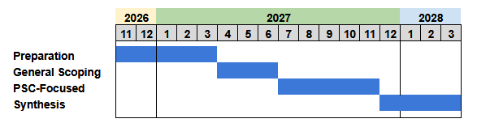

# Process

## Timeline

This project will progress through four distinct phases. The preparation phase has started as part of the proposal development. The general scoping phase will then start off the more intensive expert process with a focus on sorting out definitions and identifying best practices, planned to coincide with the PSC’s pre-season planning activities. The bulk of the project timeline is dedicated to the PSC-focused phase, which will coordinate qualitative evaluations of specific digital twin ideas while existing decision-support tools and data flows are in active use during the season. Finally, the synthesis phase will consolidate the discussions and feedback into clear, practical recommendations and identify a shortlist of 2-3 feasible and potentially useful digital twin candidates with detailed technical specifications.

 

## Participants

### Organizing Team

* **Gottfried Pestal** ([SOLV Consulting](https://www.solv.ca/), ORCID: [0000-0002-2499-8982](https://orcid.org/0000-0002-2499-8982))

* **Scott Akenhead** (ORCID: [0000-0003-1218-3118](https://orcid.org/0000-0003-1218-3118))

### Digital Twins / Dynamic Modelling Experts  

* **Dr. Eduardo Martins** (University of Northern British Columbia, ORCID: [0000-0003-3500-9331](https://orcid.org/0000-0003-3500-9331))

* **Dr. Lene Sortland** (Norwegian Institute for Nature Research, ORCID: [0000-0001-8889-5395](https://orcid.org/0000-0001-8889-5395))

### PSC Family and Other Salmon Decision-Support Experts

* **Dr. Tomas Bird** (Fisheries and Ocean Canada, ORCID: [0000-0003-1345-6480](https://orcid.org/0000-0003-1345-6480))

* **Dr. Jon Chamberlain** (Fisheries and Oceans Canada, Division Manager - Ocean Sciences)

* **Dr. Brendan Connors** (Fisheries and Oceans Canada, ORCID: [0009-0009-7986-6221](https://orcid.org/0009-0009-7986-6221))

* **Dr. Curry Cunningham** (University of Alaska Fairbanks, ORCID: [ ORCID: [0000-0002-1234-1297](https://orcid.org/0000-0002-1234-1297))

* **Kaitlyn Dionne** (Fisheries and Oceans Canada)

* **Dr. Cameron Freshwater** (Fisheries and Oceans Canada, [Profile](https://www.researchgate.net/profile/Cameron-Freshwater))

* **Dylan Glaser** (Fisheries and Oceans Canada, [Profile](https://www.researchgate.net/profile/Dylan-Glaser))

* **Dr. Charles Hannah** (Fisheries and Oceans Canada, ORCID: [0000-0002-0238-5683](https://orcid.org/0000-0002-0238-5683))

* **Dr. Patrick Thompson** (Fisheries and Ocean Canada, ORCID: [0000-0002-5278-9045](https://orcid.org/0000-0002-5278-9045))

* **Dr. Yi Xu** (Washington Department of Fish and Wildlife, [Profile](https://www.researchgate.net/profile/Yi-Xu-49))
